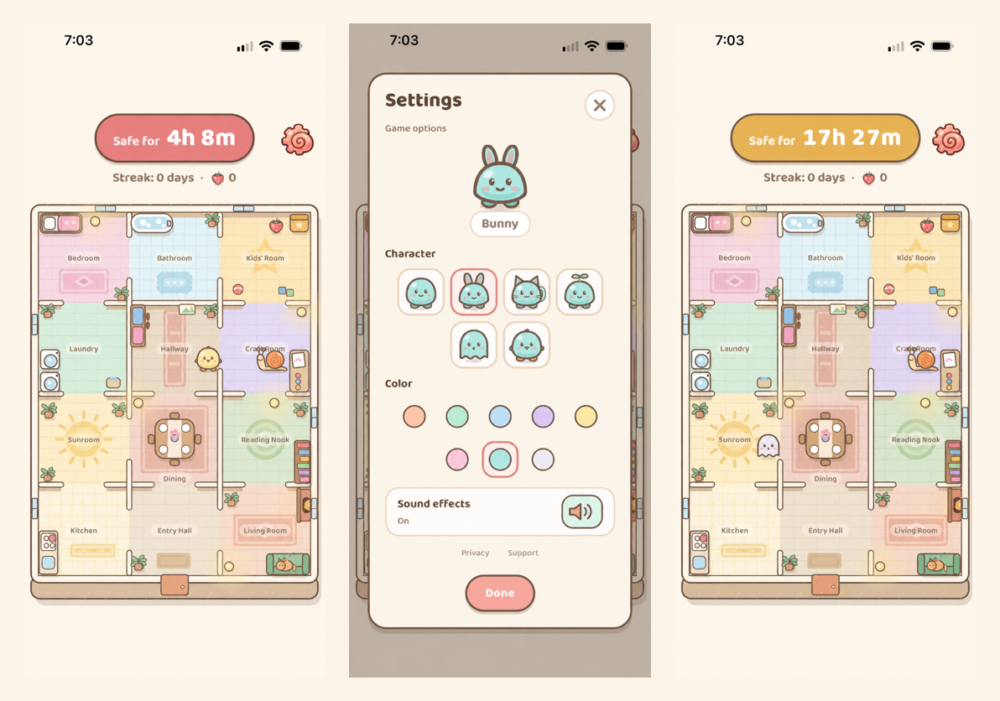

<p align="center">
  <a href="https://apps.apple.com/us/app/snail-house/id6826937107">
    
  </a>
</p>

<h1 align="center">Snail House</h1>

<p align="center">
  A slow-burn survival game about staying one step ahead of a very patient snail.
</p>

<p align="center">
  <strong><a href="https://apps.apple.com/us/app/snail-house/id6826937107">Download on IOS store</a></strong>
  &nbsp;·&nbsp;
  <a href="https://hi-dad.github.io/snail-house-support/support.html">Support</a>
  &nbsp;·&nbsp;
  <a href="https://hi-dad.github.io/snail-house-support/privacy.html">Privacy</a>
</p>

<p align="center">
  <a href="https://apps.apple.com/us/app/snail-house/id6826937107">
    
  </a>
</p>

## About the game

There is a snail in the house, and it never stops chasing you—even while the app is closed.
Open the game, see how close it has crawled, then move to a safer room before it catches you.
Come back day after day to grow your streak and collect strawberries along the way.

Snail House is free on the App Store for iPhone and requires iOS 16.4 or later.

## Features

- A persistent real-time chase that continues between play sessions
- A cozy illustrated house with 12 rooms to explore
- Six playable characters and eight color choices
- A special Ghostie character that travels straight through walls and furniture
- Strawberries to collect while avoiding the snail
- Daily survival streaks and personal-best tracking
- Optional sound effects and haptic feedback
- One optional local notification, scheduled one hour before the snail catches you
- No account, ads, analytics, tracking, or cloud service

## How it works

The simulation is timestamp-based rather than a continuously running background process. When the
app opens, the pure `advance()` function calculates everything that happened while it was closed:
snail movement, strawberry events, survival time, and a possible catch.

The farthest possible head start is **40 hours**. The snail crosses one tile every **100 minutes**,
and a new strawberry appears three hours after the previous one is collected or eaten.

```text
Bedroom ─── Bathroom ─── Kids' Room
   │                         │
Laundry      Hallway ──── Craft Room
   │           │             │
Sunroom ──── Dining ─── Reading Nook
   │           │             │
Kitchen ── Entry Hall ── Living Room
```

## Local-first persistence

Progress is saved automatically on the device with AsyncStorage. The app stores the current run,
appearance choices, streak and strawberry records, sound preference, and game clock. Saves are
validated when read, the previous valid save is kept as a backup, and the format is versioned for
future migrations. Deleting the app deletes its local progress.

## Development

Snail House is built with Expo SDK 57, React Native, and TypeScript.

### Requirements

- Node.js 20.19 or newer
- npm
- Expo Go, an iOS Simulator, or an Android Emulator

### Run locally

```bash
npm install
npx expo start
```

Scan the QR code with Expo Go, or press `i`, `a`, or `w` for iOS, Android, or web.

### Quality checks

```bash
npm test
npm run typecheck
npm run lint
```

### Production iOS builds

EAS Build profiles are defined in `eas.json`:

```bash
npx eas-cli@latest build --profile production --platform ios
npx eas-cli@latest submit --platform ios --latest
```

Production build numbers are managed remotely and increment automatically.

## Project structure

| Path | Purpose |
| --- | --- |
| `App.tsx` | App lifecycle, save loading, and screen selection |
| `src/game/map.ts` | Tile grid, rooms, doorways, walls, and furniture |
| `src/game/pathfinding.ts` | Shortest paths and map-distance calculations |
| `src/game/simulation.ts` | Movement, offline advancement, catches, streaks, and strawberries |
| `src/game/constants.ts` | Timing and game-balance constants |
| `src/storage.ts` | Automatic saves, validation, backups, and migrations |
| `src/notifications.ts` | One-hour local warning scheduling |
| `src/sound.ts` | Sound effects and haptic feedback |
| `src/ui/` | Screens, settings, characters, animation, and house artwork |

## Tests

The game-logic suite covers map connectivity, doorway rules, pathfinding, maximum lead time,
strawberry behavior, offline advancement, catch timing, deterministic simulation, storage
recovery, and long-running daily play.
